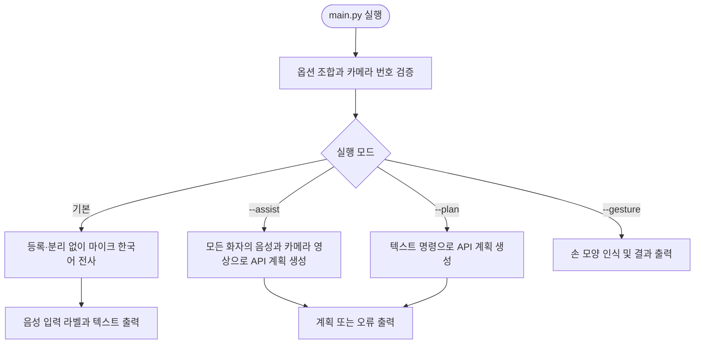
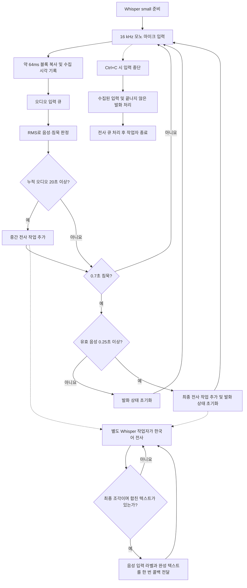
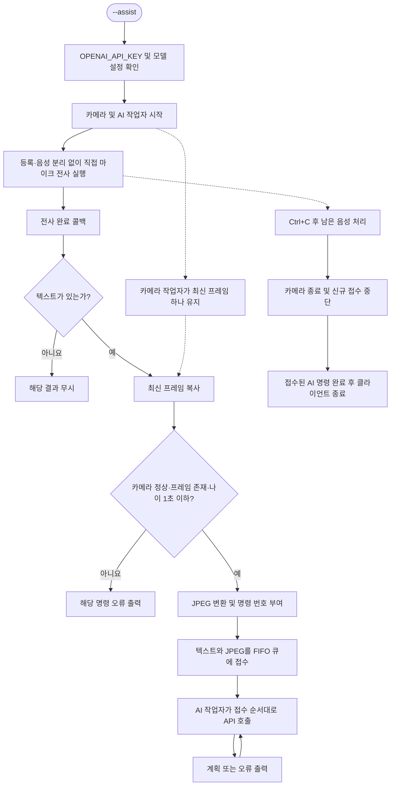
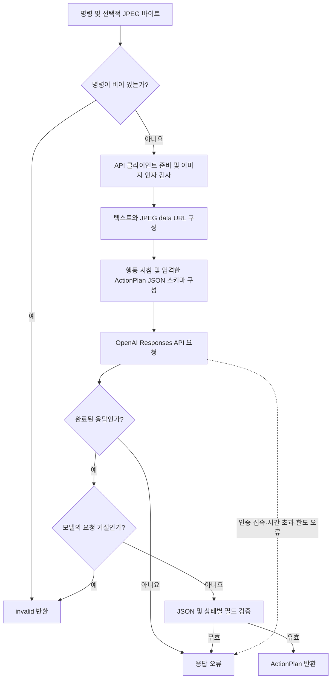
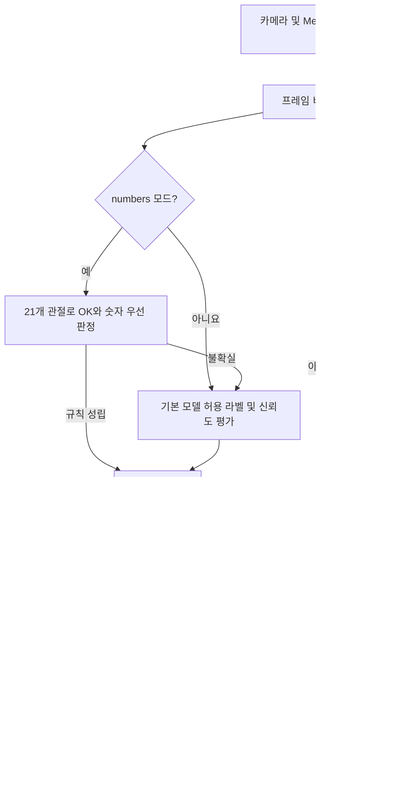
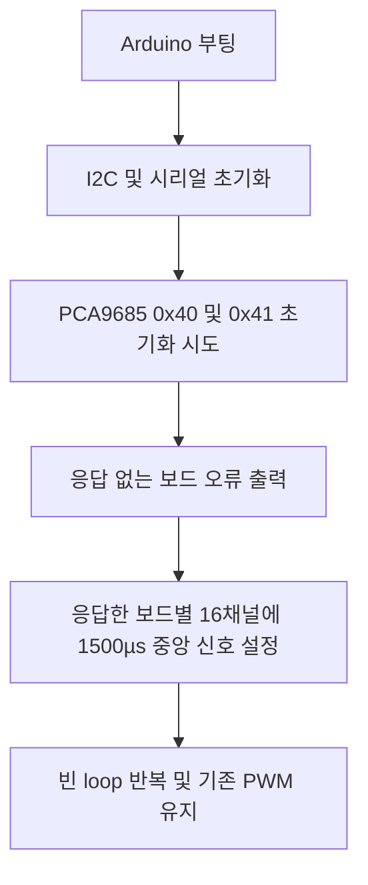

# ROBOTPAL 변경 후 동작 순서도

화자 등록·식별과 SepFormer 분리는 기본 비활성화이며, 마이크 입력을 직접 전사하고 행동 계획은 OpenAI API로 생성합니다. 수정 전 상세 분석과 순서도는 `backups/before_api_20261018_105455/FLOWCHART.md`에 보존되어 있습니다.

## 1. 전체 실행

`--enroll`은 명령행에서 제거했습니다. 기본 전사 모드와 손 모양 모드는 API 키가 필요하지 않습니다.

## 2. 직접 마이크 음성 처리

기본 전사와 통합 모드는 SepFormer·ECAPA·화자 등록 파일을 사용하지 않습니다. 4초 분리 창, 채널 연결, 중첩 혼합, 분리 작업자와 분리 속도 측정이 실행되지 않습니다. 겹친 목소리는 분리하지 않고 하나의 마이크 입력으로 처리합니다. 출력은 `[음성 입력]`입니다.

종료 시 마지막 오디오 수집 시각을 유지해 발화를 마무리합니다. Whisper 전사가 느리면 별도 전사 큐의 대기는 발생할 수 있습니다. 기존 분리 코드는 `run_separated_transcription`에 남아 있으며 기본 실행에서 호출하지 않습니다. 변경 직전 원본은 `backups/before_direct_mic_20261018_110826/`에 보존했습니다.

## 3. 모든 화자의 음성·영상 명령 접수

등록자·미등록자·`기타`를 구분하는 권한 필터가 없습니다. 각 명령은 전사 완료 시점에 복사한 JPEG를 유지합니다. 반복 명령도 각각 처리하며 영상 파일을 저장하지 않습니다. AI 대기 큐에 크기 제한이 없어 요청이 많으면 종료까지 시간이 늘어날 수 있습니다.

## 4. OpenAI 행동 계획 생성

기본 모델은 `gpt-5.4-mini`이며 `OPENAI_MODEL`로 변경합니다. 공식 엔드포인트를 사용하고 요청별 제한 시간은 120초, 자동 재시도는 0회, `store=False`입니다. API에는 명령 텍스트와 선택적 JPEG만 보내며 원본 마이크 오디오·지문·스트림 이름은 보내지 않습니다.

`plan`은 비어 있지 않은 요약과 단계 및 빈 error를 요구합니다. `invalid`는 빈 요약·빈 단계와 거절 이유를 요구합니다. 구조 검증은 동작의 실제 실행 가능성을 독립적으로 확인하는 제어기가 아닙니다.

## 5. 손 모양 인식

숫자 모드에서 규칙이 불확실하면 `Pointing_Up`, `Victory`, `Open_Palm`을 억제합니다. 인식 결과가 300ms 이상 사라지면 중복 방지 상태를 해제합니다. 손 모양은 AI 명령이나 Arduino 제어로 자동 연결되지 않습니다.

## 6. Arduino 독립 실행

PWM은 50Hz이며 채널 간 50ms 간격으로 설정합니다. Python과 Arduino 사이의 통신·보행 제어는 여전히 미구현입니다. 화자 등록 복원 방법과 실행 설정은 `README.md`를 참고하세요.
