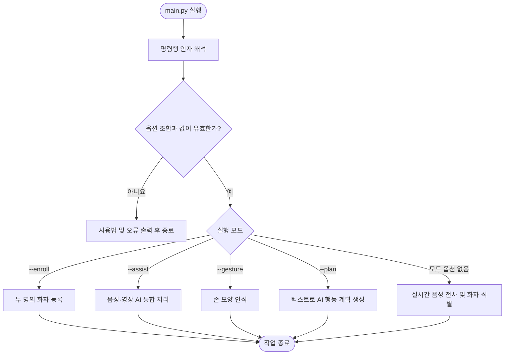
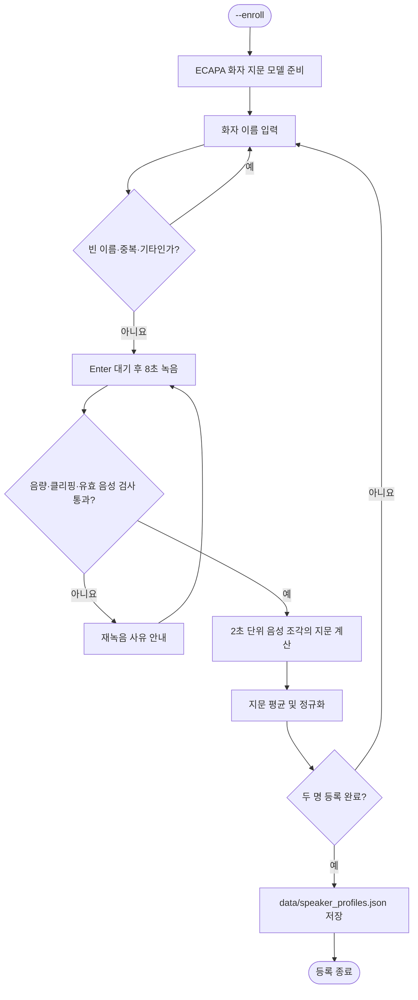
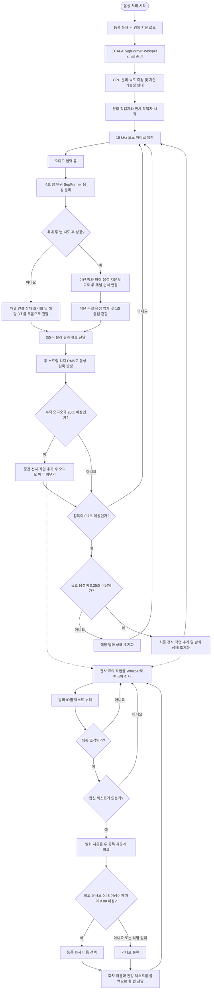
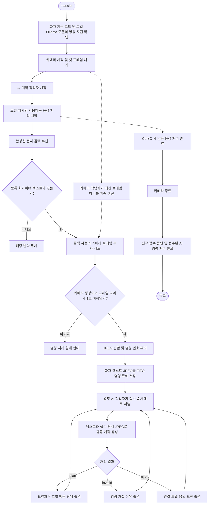
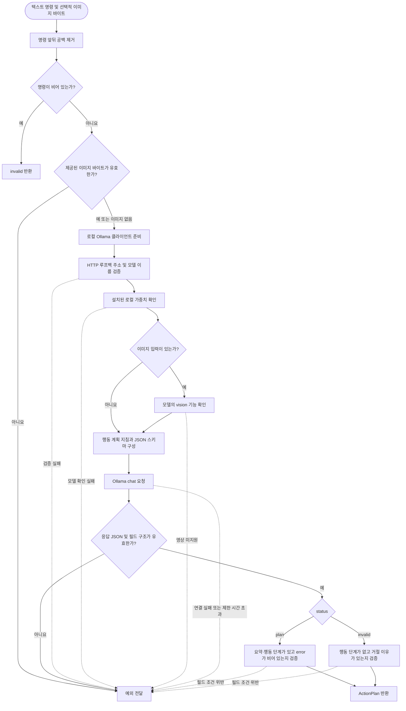
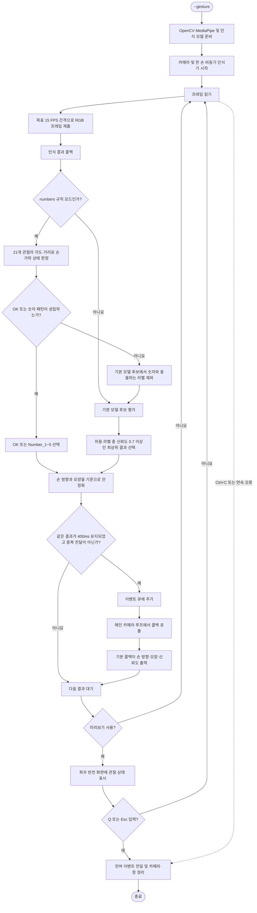
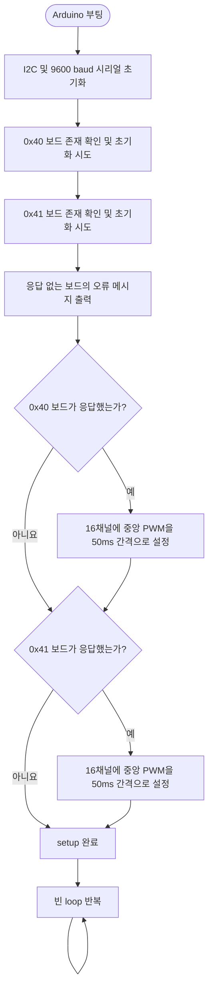
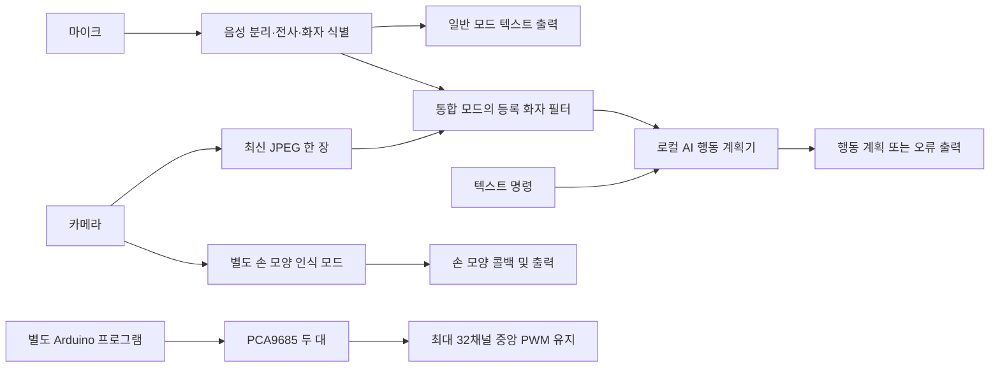

# ROBOTPAL 코드 분석 및 동작 순서도

현재 소스 코드를 기준으로 작성한 문서입니다. Mermaid를 지원하는 Markdown 뷰어에서 순서도를 볼 수 있습니다.

## 1. 프로젝트의 역할과 구현 범위

ROBOTPAL은 마이크·카메라 입력을 처리하고, 로컬 AI로 8족 로봇의 상위 행동 계획을 생성하는 프로젝트입니다. Python의 행동 계획 출력과 Arduino의 서보 초기화는 각각 독립적으로 실행됩니다. Python에서 Arduino로 명령을 보내는 통신, 행동 계획을 관절 동작으로 바꾸는 제어기, 보행 알고리즘은 현재 코드에 없습니다.

| 파일 | 실제 역할 |
|---|---|
| `main.py` | 실행 옵션 검증 및 다섯 가지 실행 모드 선택 |
| `module/speech.py` | 두 화자 등록, 중첩 음성 분리, 발화 종료 감지, 한국어 전사, 화자 식별 |
| `module/vision_assistant.py` | 등록 화자의 전사와 최신 영상 한 장을 결합하고 AI 요청을 순서대로 처리 |
| `module/action_planner.py` | 로컬 Ollama 연결·모델 확인, 계획 생성, 응답 구조 검증 |
| `module/gesture.py` | MediaPipe 손 모양 인식, 결과 안정화, 콜백 및 미리보기 |
| `module/gesture_rules.py` | 손 관절 좌표로 숫자 1~5 및 OK 판정 |
| `ai_action_planner.py` | 기존 사용 방식을 위한 텍스트 계획 진입점 |
| `sketch_oct17a/sketch_oct17a.ino` | PCA9685 두 대를 초기화하고 최대 32채널에 서보 중앙 신호 출력 |

## 2. 전체 실행 순서도

`--enroll`, `--assist`, `--gesture`, `--plan`은 동시에 선택할 수 없습니다. 옵션이 없으면 음성 전사 모드입니다.

`--camera`는 손 모양·통합 모드에서만, `--preview`와 `--rule-set`은 손 모양 모드에서만, `--command`는 텍스트 계획 모드에서만 사용할 수 있습니다. 카메라 번호는 0 이상이어야 합니다.

## 3. 화자 등록 순서도

담당 함수: `enroll_speakers`, `validate_enrollment_audio`, `average_chunk_embeddings`, `ProfileStore.save`.

유효 음성은 최소 6초가 필요합니다. 지문 계산에는 1초 이상이며 충분한 음량을 가진 조각을 사용합니다. 원본 녹음은 저장하지 않고 이름·정규화된 지문·모델 정보를 저장합니다.

## 4. 실시간 음성 처리 순서도

담당 함수·클래스: `run_live_transcription`, `StreamingSeparator`, `ChannelLinker`, `PerStreamUtteranceDetector`, `_transcription_worker`, `RegisteredSpeakerIdentifier`.

실제 작업은 큐를 통해 겹쳐 진행됩니다. 입력 수집, 음성 분리, 발화 감지, 전사는 한 작업이 끝날 때까지 전체 입력을 멈추는 구조가 아닙니다. 분리 스트림 번호는 등록 화자 이름과 고정 대응하지 않으며, 최종 발화에서 별도로 이름을 판별합니다.

화자 식별용 음성은 발화 중 음성으로 판정된 구간에서 최대 8초를 모읍니다. 일반 모드의 기본 콜백은 `[화자] 전사 내용`을 출력합니다. Ctrl+C 시 입력을 닫은 뒤 남은 분리 결과와 발화·전사 큐를 처리하고 종료합니다.

## 5. 음성·영상 AI 통합 순서도

담당 함수·클래스: `run_voice_vision_assistant`, `LatestFrameCamera`, `VoiceVisionAssistant`.

영상은 발화 시작·종료 시점이 아니라 **전사가 끝나 콜백이 호출된 시점**에 선택됩니다. AI 대기 중 카메라 화면이 바뀌어도 각 명령에 연결된 JPEG는 유지됩니다. 반복 발화도 별도 명령으로 접수되며, 프레임과 JPEG는 디스크에 저장하지 않습니다.

카메라 설정 목표는 640×480, 15 FPS이고 첫 프레임 대기는 최대 5초입니다. 읽기에 실패하면 이전 정상 프레임도 무효화하며 5회 연속 실패 시 카메라 오류 상태로 전환합니다. 명령 큐에 크기 제한이 없어 AI가 느리면 대기와 종료 시간이 늘어날 수 있습니다.

## 6. AI 행동 계획 생성 순서도

담당 함수·클래스: `create_action_plan`, `create_local_client`, `check_local_model`, `ActionPlan`.

기본 모델은 `qwen3.5:4b`, 기본 주소는 `http://127.0.0.1:11434`, 요청 제한 시간은 120초입니다. 프록시 환경 변수와 리다이렉트를 사용하지 않으며 모델을 자동 다운로드하지 않습니다. 요청은 스트리밍 없이 `temperature=0`, `think=False`로 보냅니다.

예를 들어 “앞으로 30cm 이동해”는 이동·정지 계획을, “앞으로 가”는 종료 거리나 시간이 필요하다는 거절 결과를 생성하도록 지시합니다. 이 행동 판단은 모델에 전달하는 지침이고, Python의 `ActionPlan` 검증은 응답의 구조·필드 일관성을 확인합니다. 모든 행동의 의미나 실행 가능성을 코드가 독립적으로 검증하는 것은 아닙니다. 특히 invalid의 빈 summary는 지침에 있지만 검증 함수에서 강제하지는 않습니다.

## 7. 손 모양 인식 순서도

담당 함수·클래스: `run_gesture_recognition`, `_interpret_result`, `classify_landmarks`, `GestureStabilizer`.

같은 모양을 계속 유지하면 한 번만 전달합니다. 인식 가능한 결과가 300ms 이상 사라지면 중복 방지 상태를 해제하며, 다른 손 방향·모양이 안정화되면 새 이벤트를 낼 수 있습니다. 숫자 모드에서는 OK를 숫자보다 먼저 검사하고, 규칙이 성립하지 않을 때 `Pointing_Up`, `Victory`, `Open_Palm`을 억제합니다. 규칙의 신뢰도 1.0은 모델 확률이 아닙니다.

카메라 읽기 5회 연속 실패, 인식 요청 제출 또는 결과 처리 각각 10회 연속 실패 시 오류로 종료합니다. 손 모양 결과와 로봇 행동의 대응은 아직 정의되어 있지 않고, 이 모드는 통합 AI 모드와 별도로 실행됩니다.

## 8. Arduino 서보 초기화 순서도

담당 함수: `setup`, `initializePCA9685`, `setPWMFrequency`, `centerAllServos`.

각 보드는 출력 모드와 PWM 주파수 50Hz를 설정합니다. 중앙 신호는 1500µs를 PWM 틱으로 변환해 사용하며 두 번째 보드는 A0 점퍼로 주소를 0x41로 설정해야 합니다. 보드 존재 확인 후 레지스터 쓰기의 성공 여부를 모두 검사하는 구조는 아닙니다. 이 흐름은 신호 설정을 나타내며 실제 서보 각도나 로봇의 기립 자세를 확인하지 않습니다. PCA9685는 설정된 마지막 PWM을 계속 출력합니다.

## 9. 현재 연결 관계

행동 계획 출력이나 손 모양 콜백에서 Arduino로 이어지는 연결은 없습니다. 실제 로봇 행동까지 확장하려면 통신 규약, 다리·관절 채널 배치, 동작 범위, 보행 제어 및 실행 상태 피드백을 별도로 구현해야 합니다.

이 문서는 소스 정적 분석 결과입니다. 마이크·카메라·Ollama 및 실제 서보를 구동하는 검증은 수행하지 않았습니다.
